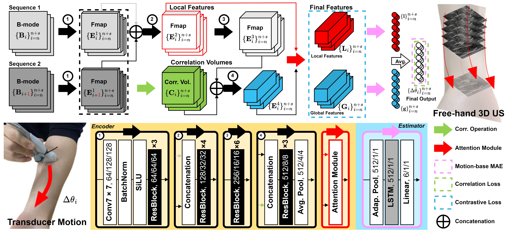
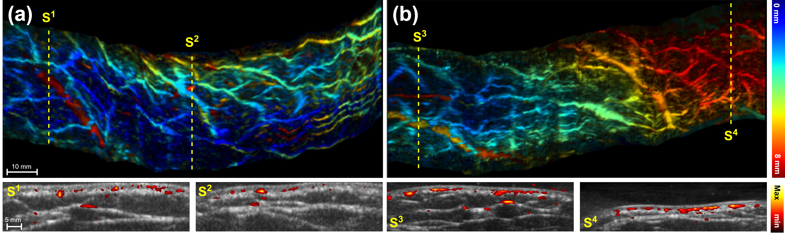

# MoGLo-Net

**Enhancing Free-Hand 3-D Photoacoustic and Ultrasound Reconstruction Using Deep Learning**  
*IEEE Transactions on Medical Imaging*, 44(11), 4652–4665, 2025

MoGLo-Net estimates six-degree-of-freedom probe motion from consecutive B-mode ultrasound images, without an external tracking sensor. It combines patch-wise feature correlation, global-local attention, and recurrent motion estimation. Predicted scan trajectories are used for 3D reconstruction of ultrasound, power Doppler, and photoacoustic images.

[**Paper**](https://doi.org/10.1109/TMI.2025.3579454)

---

### Architecture



### Qualitative Results

**B-mode (in-house)**


**B-mode (public)**


**Power Doppler**


**Photoacoustic imaging**


---

## 1. Environment

The repository includes a Docker-based environment for dependencies such as PyTorch3D.

```bash
# From the host
docker pull guhong3648/guhong:v1
```

The repository also contains a `requirements.txt` file. It reflects the original research environment and includes environment-specific package references, so the Docker image is the simpler starting point.

## 2. Data

The `data/` directory contains a small sample intended to check the data-loading and execution pipeline. **It is not the full dataset used for the paper's training or evaluation.**

The public freehand ultrasound dataset used in the study is available from [Zenodo](https://zenodo.org/records/7740734), with preprocessing details in the [UCL CANDI repository](https://github.com/ucl-candi/freehand). We used the central `320 × 320` region of the original `480 × 640` B-mode frames.

For the public dataset, see:

Q. Li et al., "Trackerless Freehand Ultrasound with Sequence Modelling and Auxiliary Transformation over Past and Future Frames," *IEEE ISBI*, 2023. [DOI](https://doi.org/10.1109/ISBI53787.2023.10230773).

## 3. Repository Structure

```text
US3D/
├── README.md
├── fig/
├── data/                 # Sample data
├── src/                  # Model and experiment code
├── res/                  # Results
└── requirements.txt
```

## Citation

If you use the code or results in your work, please cite:

```bibtex
@article{Lee_2025_MoGLo,
  title   = {Enhancing Free-Hand 3-D Photoacoustic and Ultrasound Reconstruction Using Deep Learning},
  author  = {Lee, SiYeoul and Kim, Seonho and Seo, MinKyung and Park, SeongKyu and Imrus, Salehin and Ashok, Kambaluru and Lee, DongEon and Park, Chunsu and Lee, SeonYeong and Kim, Jiye and Yoo, Jae-Heung and Kim, MinWoo},
  journal = {IEEE Transactions on Medical Imaging},
  volume  = {44},
  number  = {11},
  pages   = {4652--4665},
  year    = {2025},
  doi     = {10.1109/TMI.2025.3579454}
}
```

## Contact

SiYeoul Lee — guhong3648@naver.com
